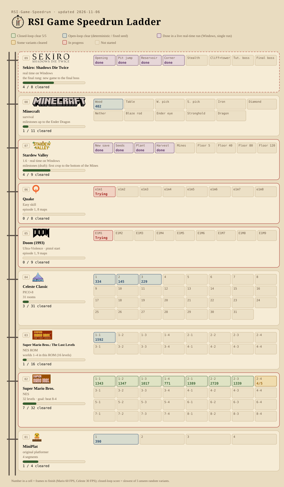

#  Recursive Self-Improvement for Game Speedrun

[中文](README.md)

## Dispatches

**🔴 LIVE · On Air Now**

- 🔴 **Stardew Valley**: further down the Mines, floor 6 so far (live on Windows). _(since 11-09 13:11)_
- 🔴 **Sekiro**: General Kawarada defeated, onwards (live on Windows). _(since 11-12 17:27)_

- **2026-11-14 20:30** **Super Mario Bros. 8-2** now finishes 3/5 random variants (fastest 1843 frames) and 8-4 stays at 4/5; both are still a few variants short, and attempts are paused for now. The recording now shows the new 8-2 run.
- **2026-11-14 18:30** **Super Mario Bros.**: recording of all 32 levels from 1-1 to 8-4 is up (for levels not yet cleared on every variant it shows a run that finished), plus one of the 16 levels of worlds 5-8, under Recordings & Results. Every one of the remaining 8 levels now finishes some random variants: 5-3 and 8-4 4/5; 5-4, 7-1 and 8-3 3/5; 7-2, 7-3 and 8-2 2/5, so all 32 levels finish at least one. 8-2 and 8-4 are being attempted now.
- **2026-11-12 17:27** **Sekiro**: **General Naomori Kawarada** defeated. From a Sculptor's Idol, unseen round behind him for a plunge Deathblow, then the fight until he falls. Recording under Recordings & results (live on Windows).
- **2026-11-12 04:25** **Super Mario Bros. 5-2** cleared: 1553 frames (about 25.9 s), 5/5 unseen random variants. 24 of 32 levels cleared.
- **2026-11-12 01:10** **Super Mario Bros. 6-4** cleared: 1377 frames (about 23.0 s), 5/5 unseen random variants. World 6 complete. 23 of 32 levels cleared.
- **2026-11-11 17:15** **Super Mario Bros. 8-1** cleared: 3767 frames (about 62.8 s), 5/5 unseen random variants, the first level of world 8. 22 of 32 levels cleared.
- **2026-11-11 16:35** **Super Mario Bros. 6-3** cleared: 1664 frames (about 27.7 s), 5/5 unseen random variants. 21 of 32 levels cleared.
- **2026-11-11 13:24** **Super Mario Bros. 7-4** (the maze castle) cleared: 1228 frames (about 20.5 s), 5/5 unseen random variants; it takes the right path through every maze section without being looped back. 20 of 32 levels cleared.
- **2026-11-11 12:11** **Super Mario Bros. 5-1** cleared: 1492 frames (about 24.9 s), 5/5 unseen random variants, the first level of world 5. 19 of 32 levels cleared.
- **2026-11-11 10:32** **Super Mario Bros. 6-1 and 6-2** cleared: 1294 / 2362 frames (about 21.6 / 39.4 s), each 5/5 unseen random variants. Worlds 5–8 are under way; 18 of 32 levels are cleared.
- **2026-11-11 10:01** **Sekiro**: **prologue done**. From after Yamauchi's defeat: the guard killed, the Pellet, through Kuro's door, the escort, the fight with Genichiro Ashina (a scripted loss), then awake at the **Dilapidated Temple** with the Shinobi Prosthetic. Recording under Recordings & results (live on Windows).
- **2026-11-10 16:34** **Sekiro**: the first mini-boss, **Shigenori Yamauchi**, defeated. From Kuro's room (a save), across the yard, finished with two Deathblows. Recording under Recordings & results, and the cliff-to-tower stretch is done too, with a recording from the cliff all the way to Kuro's room (live on Windows).
- **2026-11-09 14:04** **Doom E1M1** cleared on Hurt Me Plenty: 556 frames (about 15.9 s), 5/5 unseen random variants, and all 40 further unseen variants. Ultra-Violence stays at 4/5 (18 of 40 further variants). The recording is updated under Recordings & results.
- **2026-11-09 13:11** **Stardew Valley**: one unbroken run from Mines floor 1 down to floor 6 (about 11 min 28 s, not an official score). Recording under Recordings & results (live on Windows).
- **2026-11-09 12:05** **Doom E1M1**: 4 of 5 unseen random variants now reach the exit (fastest 505 frames, about 14.4 s), up from 2. On 40 further unseen variants it finishes 18 (up from 7), so it is not stable yet.
- **2026-11-08 18:25** **Stardew Valley**: from a Spring 5 save it now walks to the Mines by itself, and scored attempts at floors 1→5 have started. None has reached floor 5 yet; the furthest got to floor 3, stopped by geode item dialogs and slimes (live on Windows).
- **2026-11-07 18:45** **Super Mario Bros. 3-4** (castle) cleared: 4418 frames (about 73.6 s), 5/5 unseen random variants. All 16 levels from 1-1 to 4-4 are cleared; the 16-level recording is updated under Recordings & Results.
- **2026-11-07 17:25** **Doom E1M1**: 2 of 5 unseen random variants now reach the exit (fastest 626 frames, about 17.9 s); the other 3 get 89% of the way, so it stays unstable. **Super Mario Bros. 3-4**: 4 of 5 variants, also one short. The recording is now the 626-frame run.
- **2026-11-07 15:42** **Doom E1M1** (Ultra-Violence, pistol start) reached the exit for the first time: 653 frames (about 18.7 s), but on only 1 of 5 unseen random variants, so it is marked unstable; the other 4 got 86%-93% of the way to the exit. Recording under Recordings & Results.
- **2026-11-07 01:00** **Super Mario Bros. 3-4** (castle) finished for the first time, but not yet stably: 2 of 5 unseen random variants (fastest 1524 frames), so it is marked unstable. A recording of all 16 levels from 1-1 to 4-4 back to back is under Recordings & Results.
- **2026-11-06 20:30** **Sekiro**: a recording of the Ashina Reservoir stretch from the wall to the crawl space, including hiding under the floor until a guard's alert drops, is now under Recordings & Results (live on Windows).
- **2026-11-06 18:05** **Super Mario Bros. 3-1** cleared: 2166 frames, 5/5. Only 3-4 is left in worlds 3 and 4.
- **2026-11-06 16:31** **Stardew Valley**: day 5 with no human input at all, from the house down to floor 3 of the Mines (out of energy). Recording under Recordings & results (live on Windows).
- **2026-11-06 16:00** **Stardew Valley**: one unbroken run from a new save: clears a path across the farm on day 1, and on day 5, after the parsnips, walks through the Backwoods into the Mines and reaches floor 1 (out of energy) (live on Windows).
- **2026-11-06 14:40** **Super Mario Bros. 4-2 and 4-4** (castle) cleared: 1885 / 1226 frames, both 5/5. 3-2, 3-3, 4-1 and 4-3 improved to 1188 / 991 / 1425 / 880 frames. Only 3-1 and 3-4 are left in worlds 3 and 4.
- **2026-11-06 13:00** **Super Mario Bros. 3-2, 3-3, 4-1 and 4-3** cleared: 1269 / 1244 / 1624 / 940 frames, all 5/5. Left in worlds 3 and 4: 3-1, 3-4, 4-2, 4-4.
- **2026-11-06 11:40** **Stardew Valley**: into the Mines; breaks rocks, finds ladders and goes down from floor 1 to 3 (live on Windows, exploration save).
- **2026-11-06 11:19** **Sekiro**: from the wall corner into the grass, waiting out the talking guards, on to the crawl space (live on Windows).
- **2026-11-06 11:10** **Super Mario Bros. 2-4** (castle) cleared: 1264 frames, 5/5 unseen variants. Worlds 1 and 2 are complete.
- **2026-11-06 10:00** **Super Mario Bros. 2-2** (underwater) cleared: 2720 frames, 5/5. 1-4 improved to 771 frames and 2-1 to 1389.
- **2026-11-06 08:28** **Super Mario Bros. 1-4, 2-1 and 2-3** cleared: 886 / 1760 / 1339 frames, all 5/5.
- **2026-11-06 07:41** **Stardew Valley**: from a new save to the first 5 parsnips on Spring 5 (live on Windows).
- **2026-11-06 00:23** **Super Mario Bros. 1-3** cleared: 1017 frames, 5/5; 1-2 improved to 1347 frames.
- **2026-11-05 23:16** **Sekiro**: past the opening pit, the Ashina Reservoir rock face and the wall corner (live on Windows).
- **2026-11-05 22:54** **Super Mario Bros. 1-2** first clear: 1545 frames, 5/5.
- **2026-11-05 09:30** **Super Mario Bros. 1-1**: first clear on random variants, 1485 frames, 5/5 (1482 by noon).
- **2026-11-04 21:12** **Celeste Classic** rooms 1–3 cleared: 334 / 145 / 229 frames (30 FPS).
- **2026-11-04** First batch: **Minecraft** gets wood (402 frames); **Lost Levels** 1-1 cleared (fixed seed, 1592 frames).

<picture>
  <source media="(prefers-color-scheme: dark)" srcset="ladder.en.dark.svg">
  
</picture>

| Rung | Game | | Segments | Cleared |
|---|---|---|---|---|
| 08 | Sekiro: Shadows Die Twice | real time on Windows | 10 | 9 |
| 07 | Minecraft | survival | 11 | 1 |
| 06 | Stardew Valley | 1.6 · real time on Windows | 9 | 6 |
| 05 | Quake | Easy skill | 8 | 0 |
| 04 | Doom (1993) | Hurt Me Plenty · pistol start | 9 | 1 |
| 03 | Celeste Classic | PICO-8 | 31 | 3 |
| 02 | Super Mario Bros.: The Lost Levels | NES ROM | 16 | 1 |
| 01 | Super Mario Bros. | NES | 32 | 24 |

## Super Mario Bros. · Results (60 FPS)

| Level | Frames | Seconds | Variants |
|---|---|---|---|
| 1-1 | 1482 | 24.7 | 5/5 |
| 1-2 | 1347 | 22.4 | 5/5 |
| 1-3 | 1017 | 16.9 | 5/5 |
| 1-4 | 771 | 12.8 | 5/5 |
| 2-1 | 1389 | 23.1 | 5/5 |
| 2-2 | 2720 | 45.3 | 5/5 |
| 2-3 | 1339 | 22.3 | 5/5 |
| 2-4 | 1264 | 21.1 | 5/5 |
| 3-1 | 2166 | 36.1 | 5/5 |
| 3-2 | 1188 | 19.8 | 5/5 |
| 3-3 | 991 | 16.5 | 5/5 |
| 3-4 | 4418 | 73.6 | 5/5 |
| 4-1 | 1425 | 23.8 | 5/5 |
| 4-2 | 1885 | 31.4 | 5/5 |
| 4-3 | 880 | 14.7 | 5/5 |
| 4-4 | 1226 | 20.4 | 5/5 |
| 5-1 | 1492 | 24.9 | 5/5 |
| 5-2 | 1553 | 25.9 | 5/5 |
| 5-3 | — | — | 4/5 |
| 5-4 | — | — | 3/5 |
| 6-1 | 1294 | 21.6 | 5/5 |
| 6-2 | 2362 | 39.4 | 5/5 |
| 6-3 | 1664 | 27.7 | 5/5 |
| 6-4 | 1377 | 22.9 | 5/5 |
| 7-1 | — | — | 3/5 |
| 7-2 | — | — | 2/5 |
| 7-3 | — | — | 2/5 |
| 7-4 | 1228 | 20.5 | 5/5 |
| 8-1 | 3767 | 62.8 | 5/5 |
| 8-2 | — | — | 3/5 |
| 8-3 | — | — | 3/5 |
| 8-4 | — | — | 4/5 |

## Celeste Classic · Results (30 FPS)

| Room | Frames | Seconds |
|---|---|---|
| 1 | 334 | 11.13 |
| 2 | 145 | 4.83 |
| 3 | 229 | 7.63 |

Rules: the referee runs on 5 random variants never seen before; all must finish, and the slowest run is the score. Numbers are frames to finish; lower is better. Levels not yet finished on every variant show the pass rate (e.g. 4/5).

Game logos from Wikimedia Commons (mostly public domain; Celeste logo © Maddy Makes Games, CC BY-SA 4.0: https://commons.wikimedia.org/wiki/File:Celeste_video_game_logo.png). Trademarks belong to their owners and are used only to identify the games. Stardew Valley logo © ConcernedApe, taken from the game's cover art. The ladder emblem is an original design.
