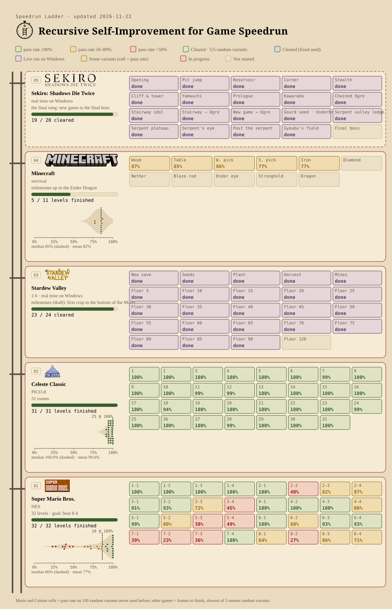

#  Recursive Self-Improvement for Game Speedrun

[中文](README.md)

## Dispatches

**🔴 LIVE · On Air Now**

- 🔴 **Stardew Valley**: further down the Mines, floor 6 so far (live on Windows). _(since 11-09 13:11)_
- 🔴 **Sekiro**: General Kawarada defeated, onwards (live on Windows). _(since 11-12 17:27)_

- **2026-11-17 15:00** The policy code for every level of **Super Mario Bros.** (32 levels) and **Celeste Classic** (31 rooms) is now public: open “Show the policy code for each level” under each game on the ladder. Each file starts with a bilingual header (pass rate, how it is run, the approach, the main parts).
- **2026-11-17 14:00** **Celeste Classic**: recording of all 31 rooms is up, from 100 m to the summit back to back, each room on a random variant never seen before (about 2 min 28 s), under Recordings & Results.
- **2026-11-17 13:30** **Celeste Classic: all 31 rooms cleared** (100 m to the summit, each room on 5 unseen random referee variants). The last ones were rooms 27, 30 and 31 (the summit). On 100 variants never used before the 31 rooms finish 3089 of 3100 (average 99.6%); 25 rooms at 100%, lowest room 18 (94%).
- **2026-11-17 11:40** **Celeste Classic** room 29 cleared (5/5 unseen referee variants), and room 28 is faster at 202 frames. **28 of 31** rooms so far; on 100 variants never used before they finish 2789 of 2800 (average 99.6%). Rooms 27, 30 and 31 are being attempted now.
- **2026-11-17 10:50** **Celeste Classic** rooms 23, 24, 25, 26 and 28 cleared (each on 5 unseen referee variants). **27 of 31** rooms so far; on 100 variants never used before the 27 rooms finish 2690 of 2700 (average 99.6%). Rooms 27, 29, 30 and 31 are being attempted now.
- **2026-11-17 09:10** **Celeste Classic** rooms 20, 21 and 22 cleared, each at 100% on 100 variants never used before. 22 of 31 rooms so far, average pass rate 99.6%. The Celeste row on the ladder now uses the same display as Mario: rooms with a finish plus the distribution of per-room pass rates. Rooms 23–31 are being attempted now.
- **2026-11-17 07:30** **Celeste Classic**: **rooms 9–19 all cleared** (each on 5 unseen random referee variants). 19 of 31 rooms so far; on 100 variants never used before the 19 rooms finish 1891 of 1900 (room 18 at 94%; 7, 11 and 12 at 99%; the rest 100%). The last rooms, 20–31, are being attempted now.
- **2026-11-17 04:30** **Celeste Classic** restarted on random variants (random start timing and random seed): **rooms 1–8 all cleared**, each on 5 unseen referee variants; tested again on 100 variants never used before, the 8 rooms finish 799 of 800 (room 7 at 99%, the rest 100%). Rooms 9–19 are being attempted now.
- **2026-11-17 01:30** **Super Mario Bros.** now shows a **large-scale pass rate**: each level's best policy is tested on **100 random variants never used before**, and the cell shows the pass rate (replacing the old “5/5 cleared”). Average over the 32 levels: **77%**; 10 levels at 100%, 15 at ≥90%; 8 below 50%, lowest 7-2 (23%) and 8-2 (27%).
- **2026-11-16 23:45** **Super Mario Bros.**: attempts wrap up here, final result **31 of 32 levels cleared**. 7-2 (underwater) finishes at best 3/5 variants in one submission; each of the 5 variants has been finished by some submission, but never all 5 by one, so by the rules it is not cleared.

<picture>
  <source media="(prefers-color-scheme: dark)" srcset="ladder.en.dark.svg">
  
</picture>

| Rung | Game | | Segments | Cleared |
|---|---|---|---|---|
| 08 | Sekiro: Shadows Die Twice | real time on Windows | 10 | 9 |
| 07 | Minecraft | survival | 11 | 1 |
| 06 | Stardew Valley | 1.6 · real time on Windows | 9 | 6 |
| 05 | Quake | Easy skill | 8 | 0 |
| 04 | Doom (1993) | Hurt Me Plenty · pistol start | 9 | 1 |
| 03 | Celeste Classic | PICO-8 | 31 | 31 (average pass rate 100%) |
| 02 | Super Mario Bros.: The Lost Levels | NES ROM | 16 | 1 |
| 01 | Super Mario Bros. | NES | 32 | 32 (average pass rate 77%) |

## Super Mario Bros. · Results (60 FPS)

| Level | Pass rate | Fastest frames | Seconds |
|---|---|---|---|
| 1-1 | 100% (100/100) | 1340 | 22.3 |
| 1-2 | 100% (100/100) | 1347 | 22.4 |
| 1-3 | 100% (100/100) | 1017 | 16.9 |
| 1-4 | 100% (100/100) | 769 | 12.8 |
| 2-1 | 100% (100/100) | 1389 | 23.1 |
| 2-2 | 40% (40/100) | 2265 | 37.8 |
| 2-3 | 82% (82/100) | 1268 | 21.1 |
| 2-4 | 87% (87/100) | 999 | 16.6 |
| 3-1 | 91% (91/100) | 2085 | 34.8 |
| 3-2 | 93% (93/100) | 1188 | 19.8 |
| 3-3 | 72% (72/100) | 991 | 16.5 |
| 3-4 | 45% (45/100) | 2416 | 40.3 |
| 4-1 | 100% (100/100) | 1419 | 23.6 |
| 4-2 | 100% (100/100) | 1885 | 31.4 |
| 4-3 | 100% (100/100) | 880 | 14.7 |
| 4-4 | 86% (86/100) | 1191 | 19.9 |
| 5-1 | 99% (99/100) | 1432 | 23.9 |
| 5-2 | 80% (80/100) | 1357 | 22.6 |
| 5-3 | 38% (38/100) | 1162 | 19.4 |
| 5-4 | 49% (49/100) | 2172 | 36.2 |
| 6-1 | 100% (100/100) | 1294 | 21.6 |
| 6-2 | 68% (68/100) | 2360 | 39.3 |
| 6-3 | 93% (93/100) | 1599 | 26.6 |
| 6-4 | 93% (93/100) | 1155 | 19.2 |
| 7-1 | 39% (39/100) | 1395 | 23.2 |
| 7-2 | 23% (23/100) | 2174 | 36.2 |
| 7-3 | 36% (36/100) | 1239 | 20.6 |
| 7-4 | 100% (100/100) | 1226 | 20.4 |
| 8-1 | 64% (64/100) | 3679 | 61.3 |
| 8-2 | 27% (27/100) | 1703 | 28.4 |
| 8-3 | 86% (86/100) | 1586 | 26.4 |
| 8-4 | 71% (71/100) | 3683 | 61.4 |

## Celeste Classic · Results (30 FPS)

| Room | Pass rate | Fastest frames | Seconds |
|---|---|---|---|
| 1 | 100% (100/100) | 95 | 3.17 |
| 2 | 100% (100/100) | 96 | 3.20 |
| 3 | 100% (100/100) | 130 | 4.33 |
| 4 | 100% (100/100) | 82 | 2.73 |
| 5 | 100% (100/100) | 72 | 2.40 |
| 6 | 100% (100/100) | 52 | 1.73 |
| 7 | 99% (99/100) | 132 | 4.40 |
| 8 | 100% (100/100) | 89 | 2.97 |
| 9 | 100% (100/100) | 87 | 2.90 |
| 10 | 100% (100/100) | 128 | 4.27 |
| 11 | 99% (99/100) | 91 | 3.03 |
| 12 | 99% (99/100) | 49 | 1.63 |
| 13 | 100% (100/100) | 102 | 3.40 |
| 14 | 100% (100/100) | 106 | 3.53 |
| 15 | 100% (100/100) | 71 | 2.37 |
| 16 | 100% (100/100) | 129 | 4.30 |
| 17 | 100% (100/100) | 97 | 3.23 |
| 18 | 94% (94/100) | 183 | 6.10 |
| 19 | 100% (100/100) | 65 | 2.17 |
| 20 | 100% (100/100) | 115 | 3.83 |
| 21 | 100% (100/100) | 62 | 2.07 |
| 22 | 100% (100/100) | 142 | 4.73 |
| 23 | 100% (100/100) | 54 | 1.80 |
| 24 | 99% (99/100) | 109 | 3.63 |
| 25 | 100% (100/100) | 103 | 3.43 |
| 26 | 100% (100/100) | 129 | 4.30 |
| 27 | 100% (100/100) | 215 | 7.17 |
| 28 | 99% (99/100) | 178 | 5.93 |
| 29 | 100% (100/100) | 77 | 2.57 |
| 30 | 100% (100/100) | 55 | 1.83 |
| 31 | 100% (100/100) | 32 | 1.07 |

Rules: each Super Mario Bros. level and each Celeste Classic room is tested on 100 random variants never used before; the cell shows the pass rate (share of variants finished), and the fastest run's frames are kept too. Other games: the referee runs on 5 random variants never seen before; all must finish, and the slowest run is the score. Numbers are frames to finish; lower is better; levels not yet finished on every variant show the pass rate (e.g. 4/5).

Game logos from Wikimedia Commons (mostly public domain; Celeste logo © Maddy Makes Games, CC BY-SA 4.0: https://commons.wikimedia.org/wiki/File:Celeste_video_game_logo.png). Trademarks belong to their owners and are used only to identify the games. Stardew Valley logo © ConcernedApe, taken from the game's cover art. The ladder emblem is an original design.
