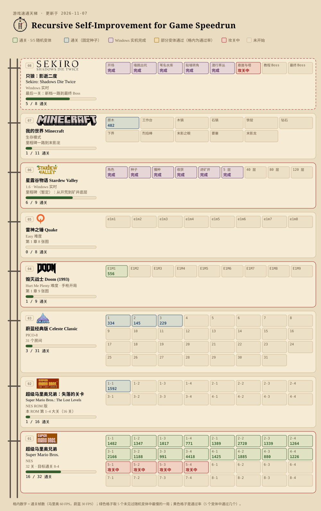

#  Recursive Self-Improvement for Game Speedrun

游戏速通天梯

[English](README.en.md)

## 战报

**🔴 LIVE · 正在攻关**

- 🔴 **星露谷物语**：矿井继续往下打，已到第 6 层（Windows 实机）。 _(开始于 11-09 13:11)_
- 🔴 **只狼**：打通从爬行通道经悬崖到塔的这一段，之后往教程 Boss 推进（Windows 实机）。 _(开始于 11-10 16:37)_

- **2026-11-10 16:34** **只狼**：击败第一个中 Boss **山内重则**。从九郎的房间（存档）出发，穿过庭院，两次忍杀将其击败。录像见“录像与数据”（Windows 实机）。
- **2026-11-09 14:04** **毁灭战士 E1M1** 通关（Hurt Me Plenty 难度）：556 帧（约 15.9 秒），5/5 个没见过的随机变体；另外 40 个没见过的变体也全部通过。Ultra-Violence 难度仍是 4/5（另外 40 个变体通过 18 个）。录像已更新，见“录像与数据”。
- **2026-11-09 13:11** **星露谷物语**：矿井一次连续运行从第 1 层打到第 6 层（约 11 分 28 秒，未计入正式成绩）。录像见“录像与数据”（Windows 实机）。
- **2026-11-09 12:05** **毁灭战士 E1M1**：5 个没见过的随机变体中通过 4 个（最快 505 帧，约 14.4 秒），之前是 2 个。在另外 40 个没见过的变体上通过 18 个（之前 7 个），还不稳定。
- **2026-11-08 18:25** **星露谷物语**：从春季第 5 天的存档自动走到矿井，开始计分挑战 1→5 层。第一轮还没到 5 层，最远 3 层，卡在开晶球的物品对话框和史莱姆上（Windows 实机）。
- **2026-11-07 18:45** **超级马里奥兄弟 3-4**（城堡）通关：4418 帧（约 73.6 秒），5/5 个没见过的随机变体。1-1 到 4-4 共 16 关全部通关；16 关连播录像已更新，见“录像与数据”。
- **2026-11-07 17:25** **毁灭战士 E1M1** 5 个没见过的随机变体中通过 2 个（最快 626 帧，约 17.9 秒），其余 3 个打到离出口 89% 的地方，仍标为“不稳定”。**超级马里奥兄弟 3-4** 5 个变体中通过 4 个，同样还差一个。录像已换成 626 帧这一局。
- **2026-11-07 15:42** **毁灭战士 E1M1**（UV 难度、手枪开局）第一次打到出口：653 帧（约 18.7 秒），但 5 个没见过的随机变体中只通过 1 个，先标为“不稳定”；其余 4 个打到了离出口 86%–93% 的地方。录像见“录像与数据”。
- **2026-11-07 01:00** **超级马里奥兄弟 3-4**（城堡）第一次通关，但还不稳定：5 个没见过的随机变体中通过 2 个（最快 1524 帧），先标为“不稳定”。1-1 到 4-4 共 16 关连播录像已上线，见“录像与数据”。
- **2026-11-06 20:30** **只狼**：苇名水库从墙边到爬行通道这一段加上了录像：被守卫发现后会躲到地板下等警报解除。见“录像与数据”（Windows 实机）。
- **2026-11-06 18:05** **超级马里奥兄弟 3-1** 通关：2166 帧，5/5。第 3、4 大关只剩 3-4。
- **2026-11-06 16:31** **星露谷物语**：第 5 天全程无人干预，从家出门一路走到矿井并下到第 3 层（体力用完）。录像见“录像与数据”（Windows 实机）。
- **2026-11-06 16:00** **星露谷物语**：从新档开始一路不停：第 1 天清出农场通道，第 5 天收完防风草后穿过后山走进矿井，到达第 1 层（体力用完）（Windows 实机）。
- **2026-11-06 14:40** **超级马里奥兄弟 4-2、4-4**（城堡）通关：1885 / 1226 帧，均 5/5。3-2、3-3、4-1、4-3 提速到 1188 / 991 / 1425 / 880 帧。第 3、4 大关只剩 3-1、3-4。
- **2026-11-06 13:00** **超级马里奥兄弟 3-2、3-3、4-1、4-3** 通关：1269 / 1244 / 1624 / 940 帧，均 5/5。第 3、4 大关还剩 3-1、3-4、4-2、4-4。
- **2026-11-06 11:40** **星露谷物语**：进入矿井，自己敲石头、找梯子，从 1 层下到 3 层（Windows 实机，探索存档）。
- **2026-11-06 11:19** **只狼**：从贴墙转角钻进草丛，等守卫对话结束，一路走到爬行通道（Windows 实机）。
- **2026-11-06 11:10** **超级马里奥兄弟 2-4**（城堡）通关：1264 帧，5/5 个未见过的变体。第 1、2 大关全部通关。
- **2026-11-06 10:00** **超级马里奥兄弟 2-2**（水下）通关：2720 帧，5/5。1-4 提速到 771 帧，2-1 提速到 1389 帧。
- **2026-11-06 08:28** **超级马里奥兄弟 1-4、2-1、2-3** 通关：886 / 1760 / 1339 帧，均 5/5。
- **2026-11-06 07:41** **星露谷物语**：从新档一路做到春季第 5 天，收获第一批 5 个防风草（Windows 实机）。
- **2026-11-06 00:23** **超级马里奥兄弟 1-3** 通关：1017 帧，5/5；1-2 提速到 1347 帧。
- **2026-11-05 23:16** **只狼**：过开场深坑、苇名水库岩壁和贴墙转角（Windows 实机）。
- **2026-11-05 22:54** **超级马里奥兄弟 1-2** 首次通关：1545 帧，5/5。
- **2026-11-05 09:30** **超级马里奥兄弟 1-1** 首次在随机变体上通关：1485 帧，5/5（中午提速到 1482 帧）。
- **2026-11-04 21:12** **蔚蓝经典版** 房间 1–3 通关：334 / 145 / 229 帧（30 FPS）。
- **2026-11-04** 第一批：**我的世界**拿到原木（402 帧），**失落的关卡** 1-1 通关（固定种子，1592 帧）。

<picture>
  <source media="(prefers-color-scheme: dark)" srcset="ladder.dark.svg">
  
</picture>

| 档 | 游戏 | 说明 | 分段 | 已通关 |
|---|---|---|---|---|
| 08 | 只狼：影逝二度 Sekiro: Shadows Die Twice | Windows 实时 | 9 | 6 |
| 07 | 我的世界 Minecraft | 生存模式 | 11 | 1 |
| 06 | 星露谷物语 Stardew Valley | 1.6 · Windows 实时 | 9 | 6 |
| 05 | 雷神之锤 Quake | Easy 难度 | 8 | 0 |
| 04 | 毁灭战士 Doom (1993) | Hurt Me Plenty 难度 · 手枪开局 | 9 | 1 |
| 03 | 蔚蓝经典版 Celeste Classic | PICO-8 | 31 | 3 |
| 02 | 超级马里奥兄弟：失落的关卡 Super Mario Bros.: The Lost Levels | NES ROM 版 | 16 | 1 |
| 01 | 超级马里奥兄弟 Super Mario Bros. | NES | 32 | 16 |

## 超级马里奥兄弟 · 成绩（60 FPS）

| 关卡 | 帧数 | 秒 | 变体 |
|---|---|---|---|
| 1-1 | 1482 | 24.7 | 5/5 |
| 1-2 | 1347 | 22.4 | 5/5 |
| 1-3 | 1017 | 16.9 | 5/5 |
| 1-4 | 771 | 12.8 | 5/5 |
| 2-1 | 1389 | 23.1 | 5/5 |
| 2-2 | 2720 | 45.3 | 5/5 |
| 2-3 | 1339 | 22.3 | 5/5 |
| 2-4 | 1264 | 21.1 | 5/5 |
| 3-1 | 2166 | 36.1 | 5/5 |
| 3-2 | 1188 | 19.8 | 5/5 |
| 3-3 | 991 | 16.5 | 5/5 |
| 3-4 | 4418 | 73.6 | 5/5 |
| 4-1 | 1425 | 23.8 | 5/5 |
| 4-2 | 1885 | 31.4 | 5/5 |
| 4-3 | 880 | 14.7 | 5/5 |
| 4-4 | 1226 | 20.4 | 5/5 |

## 蔚蓝经典版 · 成绩（30 FPS）

| 房间 | 帧数 | 秒 |
|---|---|---|
| 1 | 334 | 11.13 |
| 2 | 145 | 4.83 |
| 3 | 229 | 7.63 |

规则：裁判在 5 个没见过的随机变体上运行，全部通关才算，成绩取最慢一局。格内数字是通关帧数，越小越好；还没有全部通过的关卡写通过率（如 4/5）。

游戏标志来自 Wikimedia Commons（多为公有领域；Celeste 标志 © Maddy Makes Games，CC BY-SA 4.0：https://commons.wikimedia.org/wiki/File:Celeste_video_game_logo.png），商标归各自权利人所有，仅用于标识游戏。星露谷物语标志 © ConcernedApe，取自游戏封面。天梯徽章为原创设计。
