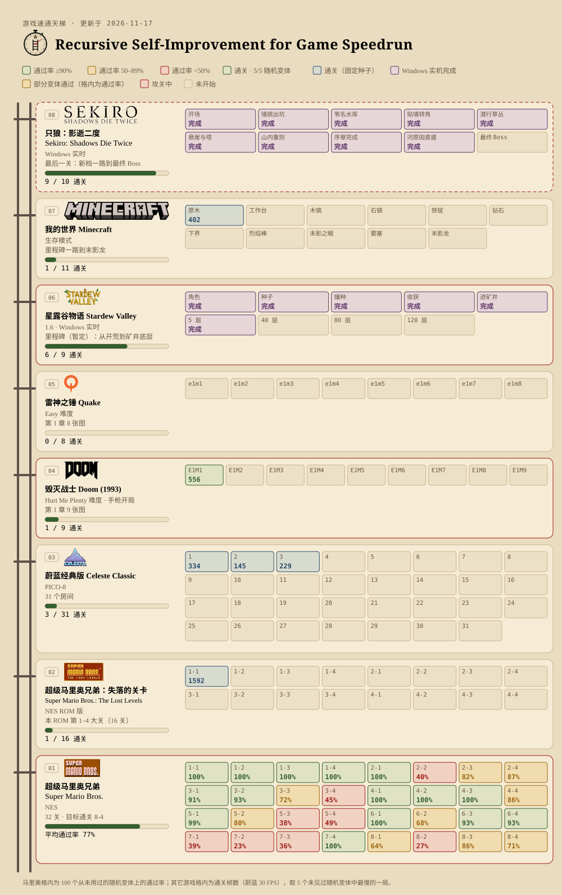

#  Recursive Self-Improvement for Game Speedrun

游戏速通天梯

[English](README.en.md)

## 战报

**🔴 LIVE · 正在攻关**

- 🔴 **星露谷物语**：矿井继续往下打，已到第 6 层（Windows 实机）。 _(开始于 11-09 13:11)_
- 🔴 **只狼**：击败河原田直盛，继续往前（Windows 实机）。 _(开始于 11-12 17:27)_

- **2026-11-17 15:00** 公开**超级马里奥兄弟**（32 关）和**蔚蓝经典版**（31 个房间）每关的策略代码：在天梯上对应游戏下方点“查看每关的策略代码”展开。每个文件开头附中英文说明（通过率、运行方式、思路概括、代码结构）。
- **2026-11-17 14:00** **蔚蓝经典版**全部 31 个房间的录像上线：从 100 m 到山顶连着播放，每个房间都是一个没见过的随机变体（约 2 分 28 秒），见“录像与数据”。
- **2026-11-17 13:30** **蔚蓝经典版全部 31 个房间通关**（100 m 到山顶，每个房间都在正式评分的 5 个没见过的随机变体上通过）。最后通过的是房间 27、30、31（山顶）。在 100 个从未用过的变体上，31 个房间共通过 3089/3100（平均 99.6%），其中 25 个房间 100%，最低为房间 18（94%）。
- **2026-11-17 11:40** **蔚蓝经典版**房间 29 通关（正式评分 5/5 个没见过的变体），房间 28 提速到 202 帧。累计 **28/31** 个房间；在 100 个从未用过的变体上共通过 2789/2800（平均 99.6%）。剩下 27、30、31 正在攻关。
- **2026-11-17 10:50** **蔚蓝经典版**房间 23、24、25、26、28 通关（每个都在正式评分的 5 个没见过的变体上通过）。累计 **27/31** 个房间；在 100 个从未用过的变体上，27 个房间共通过 2690/2700（平均 99.6%）。剩下 27、29、30、31 正在攻关。
- **2026-11-17 09:10** **蔚蓝经典版**房间 20、21、22 通关，在 100 个从未用过的变体上都是 100%。累计 22/31 个房间，平均通过率 99.6%。天梯上的蔚蓝一栏改为和马里奥相同的展示：有通过的房间数 + 各房间通过率分布图。房间 23–31 正在攻关。
- **2026-11-17 07:30** **蔚蓝经典版****房间 9–19 全部通关**（每个都在正式评分的 5 个没见过的随机变体上通过）。累计 19/31 个房间；在 100 个从未用过的变体上，19 个房间共通过 1891/1900（房间 18 为 94%，11、12、7 为 99%，其余 100%）。最后的房间 20–31 正在攻关。
- **2026-11-17 04:30** **蔚蓝经典版**改为随机变体（随机开局时机和随机种子）重新攻关：**房间 1–8 全部通关**，每个房间都在正式评分的 5 个没见过的变体上通过；再在 100 个从未用过的变体上测试，8 个房间共通过 799/800（房间 7 为 99%，其余 100%）。房间 9–19 正在攻关。
- **2026-11-17 01:30** **超级马里奥兄弟**改为公布**大规模通过率**：每关用最好的策略在 **100 个从未用过的随机变体**上测试，格内为通过率（替代原来的“5/5 通关”）。32 关平均 **77%**；10 关 100%，15 关 ≥90%；8 关低于 50%，最低为 7-2（23%）、8-2（27%）。
- **2026-11-16 23:45** **超级马里奥兄弟**：攻关告一段落，最终 **31/32 关通关**。7-2（水下关）最好一次提交通过 3/5 个变体；5 个变体每个都曾被某一次提交通过，但没有一次提交全部通过，按规则不算通关。

<picture>
  <source media="(prefers-color-scheme: dark)" srcset="ladder.dark.svg">
  
</picture>

| 档 | 游戏 | 说明 | 分段 | 已通关 |
|---|---|---|---|---|
| 08 | 只狼：影逝二度 Sekiro: Shadows Die Twice | Windows 实时 | 10 | 9 |
| 07 | 我的世界 Minecraft | 生存模式 | 11 | 1 |
| 06 | 星露谷物语 Stardew Valley | 1.6 · Windows 实时 | 9 | 6 |
| 05 | 雷神之锤 Quake | Easy 难度 | 8 | 0 |
| 04 | 毁灭战士 Doom (1993) | Hurt Me Plenty 难度 · 手枪开局 | 9 | 1 |
| 03 | 蔚蓝经典版 Celeste Classic | PICO-8 | 31 | 31（平均通过率 100%） |
| 02 | 超级马里奥兄弟：失落的关卡 Super Mario Bros.: The Lost Levels | NES ROM 版 | 16 | 1 |
| 01 | 超级马里奥兄弟 Super Mario Bros. | NES | 32 | 32（平均通过率 77%） |

## 超级马里奥兄弟 · 成绩（60 FPS）

| 关卡 | 通过率 | 最快帧数 | 秒 |
|---|---|---|---|
| 1-1 | 100% (100/100) | 1340 | 22.3 |
| 1-2 | 100% (100/100) | 1347 | 22.4 |
| 1-3 | 100% (100/100) | 1017 | 16.9 |
| 1-4 | 100% (100/100) | 769 | 12.8 |
| 2-1 | 100% (100/100) | 1389 | 23.1 |
| 2-2 | 40% (40/100) | 2265 | 37.8 |
| 2-3 | 82% (82/100) | 1268 | 21.1 |
| 2-4 | 87% (87/100) | 999 | 16.6 |
| 3-1 | 91% (91/100) | 2085 | 34.8 |
| 3-2 | 93% (93/100) | 1188 | 19.8 |
| 3-3 | 72% (72/100) | 991 | 16.5 |
| 3-4 | 45% (45/100) | 2416 | 40.3 |
| 4-1 | 100% (100/100) | 1419 | 23.6 |
| 4-2 | 100% (100/100) | 1885 | 31.4 |
| 4-3 | 100% (100/100) | 880 | 14.7 |
| 4-4 | 86% (86/100) | 1191 | 19.9 |
| 5-1 | 99% (99/100) | 1432 | 23.9 |
| 5-2 | 80% (80/100) | 1357 | 22.6 |
| 5-3 | 38% (38/100) | 1162 | 19.4 |
| 5-4 | 49% (49/100) | 2172 | 36.2 |
| 6-1 | 100% (100/100) | 1294 | 21.6 |
| 6-2 | 68% (68/100) | 2360 | 39.3 |
| 6-3 | 93% (93/100) | 1599 | 26.6 |
| 6-4 | 93% (93/100) | 1155 | 19.2 |
| 7-1 | 39% (39/100) | 1395 | 23.2 |
| 7-2 | 23% (23/100) | 2174 | 36.2 |
| 7-3 | 36% (36/100) | 1239 | 20.6 |
| 7-4 | 100% (100/100) | 1226 | 20.4 |
| 8-1 | 64% (64/100) | 3679 | 61.3 |
| 8-2 | 27% (27/100) | 1703 | 28.4 |
| 8-3 | 86% (86/100) | 1586 | 26.4 |
| 8-4 | 71% (71/100) | 3683 | 61.4 |

## 蔚蓝经典版 · 成绩（30 FPS）

| 房间 | 通过率 | 最快帧数 | 秒 |
|---|---|---|---|
| 1 | 100% (100/100) | 95 | 3.17 |
| 2 | 100% (100/100) | 96 | 3.20 |
| 3 | 100% (100/100) | 130 | 4.33 |
| 4 | 100% (100/100) | 82 | 2.73 |
| 5 | 100% (100/100) | 72 | 2.40 |
| 6 | 100% (100/100) | 52 | 1.73 |
| 7 | 99% (99/100) | 132 | 4.40 |
| 8 | 100% (100/100) | 89 | 2.97 |
| 9 | 100% (100/100) | 87 | 2.90 |
| 10 | 100% (100/100) | 128 | 4.27 |
| 11 | 99% (99/100) | 91 | 3.03 |
| 12 | 99% (99/100) | 49 | 1.63 |
| 13 | 100% (100/100) | 102 | 3.40 |
| 14 | 100% (100/100) | 106 | 3.53 |
| 15 | 100% (100/100) | 71 | 2.37 |
| 16 | 100% (100/100) | 129 | 4.30 |
| 17 | 100% (100/100) | 97 | 3.23 |
| 18 | 94% (94/100) | 183 | 6.10 |
| 19 | 100% (100/100) | 65 | 2.17 |
| 20 | 100% (100/100) | 115 | 3.83 |
| 21 | 100% (100/100) | 62 | 2.07 |
| 22 | 100% (100/100) | 142 | 4.73 |
| 23 | 100% (100/100) | 54 | 1.80 |
| 24 | 99% (99/100) | 109 | 3.63 |
| 25 | 100% (100/100) | 103 | 3.43 |
| 26 | 100% (100/100) | 129 | 4.30 |
| 27 | 100% (100/100) | 215 | 7.17 |
| 28 | 99% (99/100) | 178 | 5.93 |
| 29 | 100% (100/100) | 77 | 2.57 |
| 30 | 100% (100/100) | 55 | 1.83 |
| 31 | 100% (100/100) | 32 | 1.07 |

规则：超级马里奥兄弟的每关和蔚蓝经典版的每个房间都在 100 个从未用过的随机变体上测试，格内为通过率（通过的变体占比），另记最快一局的帧数。其它游戏：裁判在 5 个没见过的随机变体上运行，全部通关才算，成绩取最慢一局；格内数字是通关帧数，越小越好，还没有全部通过的写通过率（如 4/5）。

游戏标志来自 Wikimedia Commons（多为公有领域；Celeste 标志 © Maddy Makes Games，CC BY-SA 4.0：https://commons.wikimedia.org/wiki/File:Celeste_video_game_logo.png），商标归各自权利人所有，仅用于标识游戏。星露谷物语标志 © ConcernedApe，取自游戏封面。天梯徽章为原创设计。
